<a href="https://github.com/kelyonn/nexus">nexus</a> ·
<a href="https://github.com/kelyonn/airlock">airlock</a> ·
<a href="https://github.com/kelyonn/flux">flux</a> ·
<a href="https://github.com/kelyonn/scout">scout</a> ·
<a href="https://github.com/kelyonn/cerberus">cerberus</a> ·
<a href="https://github.com/kelyonn/foundry">foundry</a> ·
<a href="https://github.com/kelyonn/system32">system32</a> ·
<a href="https://github.com/kelyonn/darwin">darwin</a> ·
<a href="https://github.com/kelyonn/hue">hue</a> ·
<a href="https://github.com/kelyonn/shuttr">shuttr</a> ·
<a href="https://github.com/kelyonn/bengaluru-traffic-twin">traffic twin</a> ·
<a href="https://github.com/kelyonn/the-radiohead-archive">radiohead archive</a>

