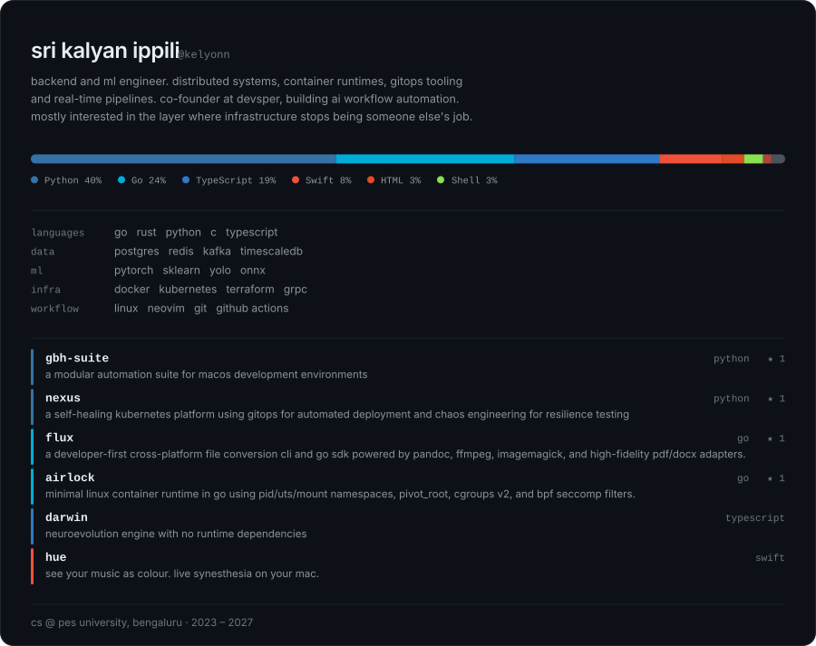

<picture>
  <source media="(prefers-color-scheme: dark)" srcset="./assets/banner-dark.svg">
  <source media="(prefers-color-scheme: light)" srcset="./assets/banner-light.svg">
  
</picture>

<!-- links:start -->

<a href="https://linkedin.com/in/sri-kalyan-ippili-6b40b5260">linkedin</a> · <a href="https://instagram.com/kalyan.1729">instagram</a> · <a href="mailto:srikalyanippili@gmail.com">email</a>&nbsp; | &nbsp;<a href="https://github.com/kelyonn/gbh-suite">gbh-suite</a> · <a href="https://github.com/kelyonn/nexus">nexus</a> · <a href="https://github.com/kelyonn/flux">flux</a> · <a href="https://github.com/kelyonn/airlock">airlock</a> · <a href="https://github.com/kelyonn/darwin">darwin</a> · <a href="https://github.com/kelyonn/hue">hue</a>

<!-- links:end -->
