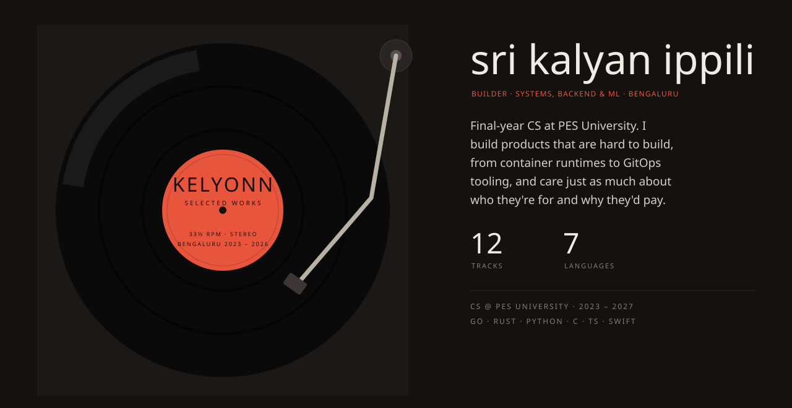

 

<a href="https://github.com/kelyonn/nexus"></a>
<a href="https://github.com/kelyonn/airlock"></a>
<a href="https://github.com/kelyonn/flux"></a>
<a href="https://github.com/kelyonn/scout"></a>
<a href="https://github.com/kelyonn/cerberus"></a>
<a href="https://github.com/kelyonn/foundry"></a>

 

<a href="https://github.com/kelyonn/system32"></a>
<a href="https://github.com/kelyonn/darwin"></a>
<a href="https://github.com/kelyonn/hue"></a>
<a href="https://github.com/kelyonn/shuttr"></a>
<a href="https://github.com/kelyonn/bengaluru-traffic-twin"></a>
<a href="https://github.com/kelyonn/the-radiohead-archive"></a>

 

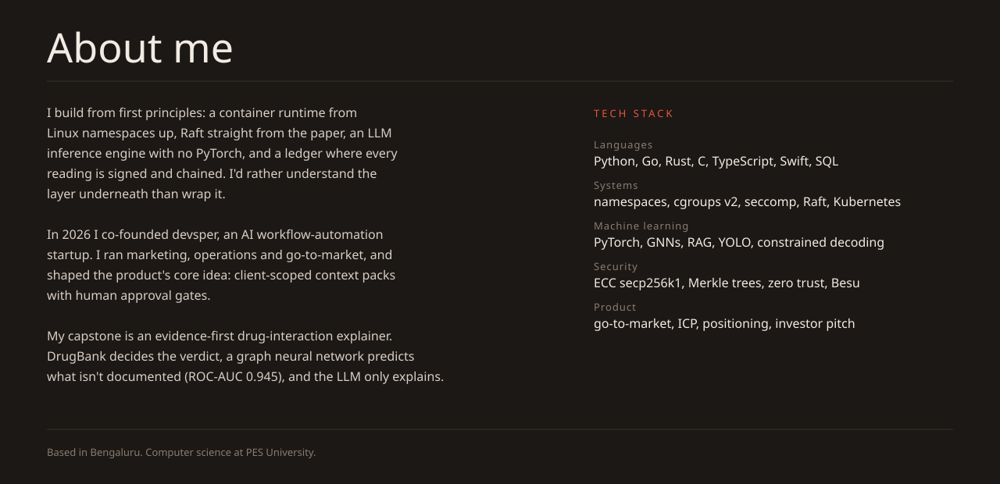

 

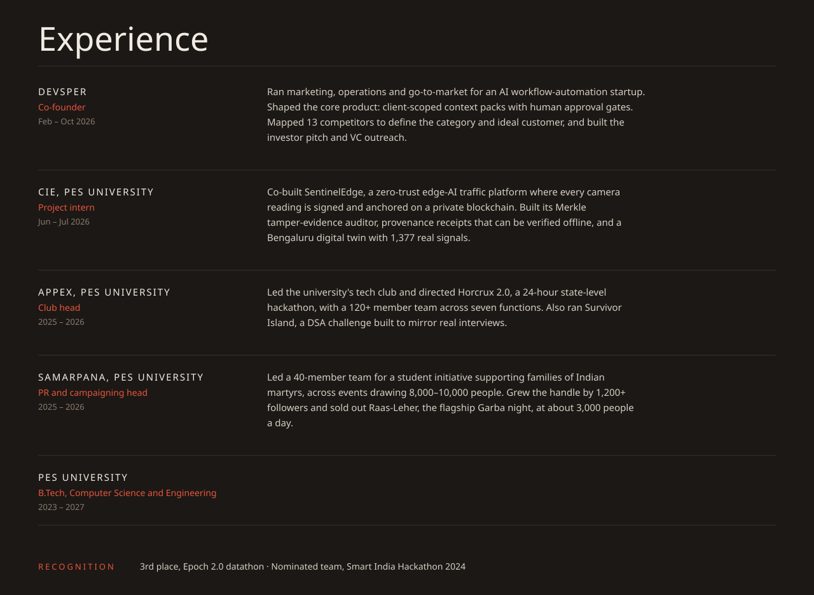

 

